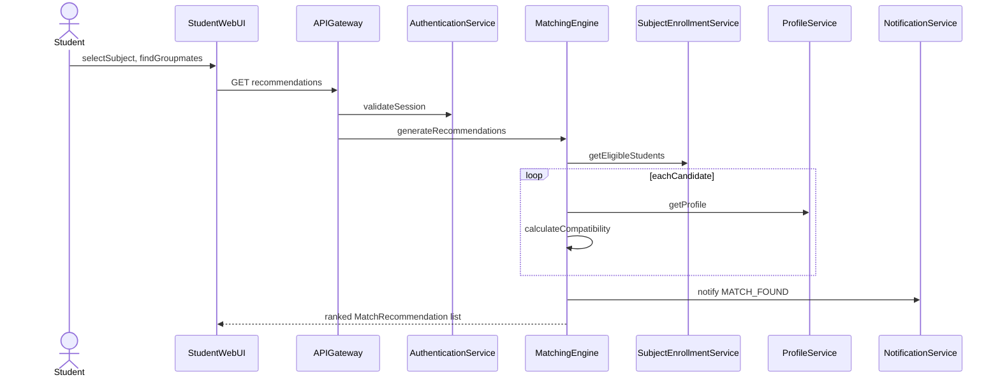

# StudySync Milestone 2: Behavioral Analysis

## Figma access check (done)
- Signed in as Colin Bactong (lukkiebactong@gmail.com) on the Starter plan with a View seat.
- Tools that write to Figma (`create_new_file`, `use_figma`) are not rate-limited.
- Tools that read from Figma (`get_screenshot`, `get_metadata`) are capped at 20 calls per month. I'll use at most about 6, only for final visual checks.
- Starter files allow 3 pages. The new file will use exactly 3 pages.
- Before the first `use_figma` call, I'll load the `figma-use` skill (`$2\figma-use\SKILL.md`). I'll also load `figma-generate-diagram` for diagramming guidance, but I won't use the `generate_diagram` tool, because the diagrams need real UML notation.

## Sources
- [MS1 Files/Group Proposal Document .md](MS1 Files/Group Proposal Document .md): functional requirements and scope
- [MS1 Files/High-Level Project Structural Analysis of StudySync.md](MS1 Files/High-Level Project Structural Analysis of StudySync.md): Section 6 already proposes use cases, the sequence flow to model, and which prototype screens to prioritize
- [MS1 Files/Project Class Diagram.md](MS1 Files/Project Class Diagram.md): class operations, used as the sequence diagram messages
- [MS1 Files/Project Component Diagram .md](MS1 Files/Project Component Diagram .md): components and interfaces, used as the sequence diagram participants
- Worksheet header: Milestone 2 Team Leader is Colin Bactong. Members are Chelsie Mae Ricafrente, Angelica Mae Calipayan and Charlize Bactong. Program is BSIT Marketing Technology & Software Development.

## Figma file: "StudySync Milestone 2" (new, 3 pages)
1. **Use Case Diagram**
2. **Sequence Diagram**
3. **Low-Fidelity Prototype**

Every page will include a legend frame. The diagrams will use grayscale UML notation.

## Phase 1: Use Case Diagram worksheet
**Actors**
- Student (primary)
- Administrator (secondary)
- Both are specializations of User, drawn with actor generalization.
- There are no external systems. MS1 explicitly excludes Coursera, MyCamu, Google Meet and Google Workspace, so there will be one system boundary, "StudySync".

**Use cases inside the boundary**
- UC-01 Register Account
- UC-02 Log In / Log Out
- UC-03 Manage Collaboration Profile
  - includes Set Availability
  - extended by Provide Work Schedule, when the student is a working student
- UC-04 Manage Subject Enrollment, including the looking-for-group setting
- UC-05 Find Potential Groupmates
  - includes Calculate Compatibility
  - extended by View Candidate Profile
- UC-06 Send Groupmate Request, extending UC-05
- UC-07 Respond to Groupmate Request (accept or decline)
- UC-08 Form Project Group, extending UC-07 on accept
- UC-09 View Notifications
- UC-10 Report User
- UC-11 Manage Student Accounts (Admin)
- UC-12 Manage Subjects (Admin)
- UC-13 Review Reported Users (Admin), extended by Update Account Status
- Shared included use case: Send Notification, included by UC-06, UC-07 and UC-08
- Log In is included by the use cases that require authentication

**Worksheet edits** to [MO-IT115 Homework_ Project Use Case Diagram ....md](MO-IT115 Homework_ Project Use Case Diagram _ H3101 _ Colin Bactong Chelsie Mae Ricafrente Angelica Mae Calipayan Charlize Bactong.md):
- Fill in the header, Project Context, Actor table and Use Case table.
- Add the diagram image (`StudySync_Use_Case_Diagram.png`) and a link to the Figma page.
- Write the diagram analysis.
- Write narratives for UC-01, UC-03 and UC-04 through UC-08, UC-10 and UC-13. Each narrative will have an ID and name table, a definition table, normal flow and alternative flow.
- Fix the template's duplicate "Postconditions" row in narrative 1 so it reads "Preconditions".
- Remove the instructions section.

## Phase 2: Sequence Diagram worksheet, UC-05 Find Potential Groupmates
**Participants**
- Student (actor)
- `StudentWebUI`
- `APIGateway`
- `AuthenticationService`
- `MatchingEngine` (implements `MatchingService`)
- `SubjectEnrollmentService`
- `ProfileService`
- `NotificationService`
- `DataAccessLayer`

**Messages** come from the MS1 operations, for example `validateSession`, `generateRecommendations(studentId, subjectId): MatchRecommendation[0..*]`, `getEligibleStudents`, `getProfile` and `calculateCompatibility`.

**Combined fragments**
- `alt`: session invalid, or no eligible candidates
- `loop`: score each candidate
- `opt`: score at or above `minimumScore`, then create the `MatchRecommendation`

**Worksheet edits** to [MO-IT115 Homework_ Project Sequence Diagram ....md](MO-IT115 Homework_ Project Sequence Diagram _ H3101 _ Colin Bactong Chelsie Mae Ricafrente Angelica Mae Calipayan Charlize Bactong.md): fill in all 9 sections, including the step table, design decisions, findings and references. The diagram image is `StudySync_Sequence_Diagram.png`.

## Phase 3: Low-Fidelity Prototype (Figma page 3)
**Format:** grayscale desktop wireframes (1440 wide), with clickable prototype links between screens set through `use_figma` reactions.

**Student screens**
- Login
- Register
- Profile Setup: IT major, employment status, work schedule, availability grid, working style
- My Subjects: looking-for-group toggle
- Potential Groupmates: ranked list with compatibility score
- Candidate Profile, with Send Request and Report User actions
- Requests Inbox: Accept and Decline, with a group-capacity alternative state
- Project Group
- Notifications

**Admin screens**
- Dashboard
- Manage Accounts
- Manage Subjects
- Review Reports

**Traceability:** a flow-map frame will label each screen with the use case ID it supports.

## Phase 4: Milestone 2 Draft document
Create a new file, `High-Level Project Behavioral Analysis of StudySync.md`, using the same structure as the MS1 Structural Analysis document:
- Executive Summary
- Project Overview
- Use Case Analysis: diagram, actors, narratives summary
- Sequence Analysis
- Low-Fidelity Prototype: screens, navigation paths, use case to screen mapping
- Consistency Check: prototype against use cases, narratives and sequence diagram, following MS2 instruction steps 5 and 6
- Behavioral Findings
- Recommendations
- References

## Image exports
The `get_screenshot` tool counts against the monthly read limit, so I'll ask you to export the PNG files from Figma yourself (File > Export, 2x) using the filenames referenced in the documents. I'll use at most a few screenshots for final checks.